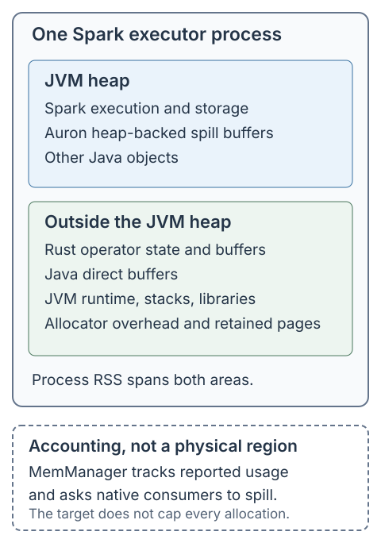
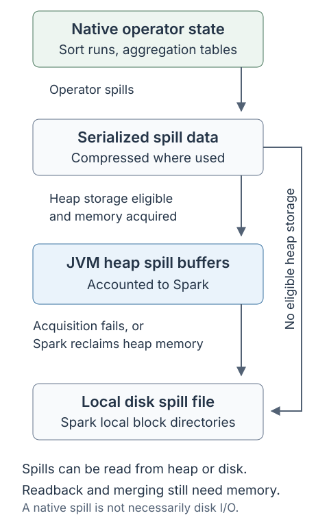

# Memory Management in Apache Auron

Auron executes native code inside the Spark executor process. The JVM heap, Java direct buffers, and Rust allocations all contribute to that process's memory footprint, but they are not managed by the same allocator.

This guide explains memory budgeting, accounting, and spilling for Auron on Spark. The implementation details and defaults below refer to [Auron revision `a1d46ccb`][revision]; check the source for your deployed version. See [Getting Started](./getting-started.md) for setup and [Configuration](./configuration.md) for the configuration reference.

## Memory model

Three different mechanisms determine whether a query fits in memory:

| Mechanism | What it controls | Important limitation |
| --- | --- | --- |
| JVM heap and Spark memory management | Java objects, Spark execution/storage memory, and Auron's on-heap spill buffers | Spark's accounting does not cover every Java object or native allocation. |
| Auron's native memory manager | Usage reported by registered native operators; when those operators should spill | It is cooperative accounting, not an allocator or a hard cap on native memory. |
| Operating system and deployment limits | Physical memory pressure and, where configured, container memory usage | The process can be killed even when Auron's reported usage is below its target. |



*Conceptual layout, not a proportional memory allocation. Accounting targets do not reserve physical regions of memory.*

**Off-heap does not mean Spark-managed off-heap.** Rust and Arrow can allocate memory outside the JVM heap even when `spark.memory.offHeap.enabled=false`, as recommended in Getting Started. Auron's native memory manager does not acquire each native operator's bytes from Spark's off-heap execution pool. Do not use `spark.memory.offHeap.size` as the native budget described below.

The JVM heap also contains memory outside Spark's managed execution and storage pools. Outside the heap, the process needs room for native operator state, Arrow buffers, thread stacks, JVM runtime structures, libraries, and allocator overhead. There is no separately enforced pool for each of these uses.

## How the native budget is calculated

On an executor, [NativeHelper][native-helper] calculates:

```text
configured total = spark.executor.memory + executor memory overhead
native allowance = configured total - Runtime.getRuntime.maxMemory()
native target    = native allowance * spark.auron.memoryFraction
```

All three memory quantities in these formulas are bytes. `Runtime.getRuntime.maxMemory()` is the JVM's maximum heap, not its current heap usage. An idle heap does not automatically enlarge the native allowance.

Explicit `spark.executor.memoryOverhead` determines the overhead term. If it is absent, this Auron revision calculates `max(10% of configured executor memory, 384 MiB)`. That fallback is implemented in Auron; do not assume it follows every Spark version's or deployment environment's overhead-factor defaults. Setting overhead explicitly avoids that ambiguity.

When initialized on the driver, the calculation uses the corresponding driver settings. [Native initialization][native-init] multiplies the allowance by `spark.auron.memoryFraction`, which defaults to `0.6`, and creates the process-wide native memory manager once. This is not a fresh budget for each task or native plan. Set these configurations before native execution starts.

The native target leaves room for allocations not covered by operator accounting, but it does not reserve that room or prevent other allocations from using it. Auron's configured total is also not a measurement of the actual container limit.

### Example: 4 GiB heap and 4 GiB overhead

```properties
spark.memory.offHeap.enabled false
spark.executor.memory 4g
spark.executor.memoryOverhead 4096
spark.auron.memoryFraction 0.6
```

Assume the actual maximum JVM heap is exactly 4 GiB:

| Quantity | Calculation | Result |
| --- | --- | --- |
| Configured total | 4 GiB + 4 GiB | 8 GiB |
| Native allowance | 8 GiB - 4 GiB | 4 GiB |
| Native target | 4 GiB × 0.6 | Approximately 2.4 GiB |
| Allowance outside the target | 4 GiB - 2.4 GiB | Approximately 1.6 GiB, not reserved |
| Process-pressure threshold | 8 GiB × 0.9 | Approximately 7.2 GiB |

`4096` is MiB for the Spark overhead setting. The process-pressure threshold uses the default `spark.auron.process.vmrss.memoryFraction=0.9`; it is a spill signal, not a second allocation pool.

Increasing the overhead can increase Auron's native target. Increasing only the heap usually does not increase the native allowance when overhead is explicit and the maximum heap grows by the same amount.

## Accounting and buffer ownership

The [native memory manager][memmgr] maintains a list of registered consumers and their reported usage. Sorters, aggregation tables, and shuffle repartitioners report estimates of their retained state. Consumers can be spillable during input processing and become unspillable during output.

**Reported unspillable memory and untracked memory are different.** The former is included in the manager's total and reduces the budget available to spillable consumers. The latter was never reported to this manager and does not participate in that calculation.

There is no universal pre-allocation reservation protocol. For example, sort and aggregation update their usage after processing an input batch. Sort shuffle reports a projected increase before buffering a batch, then updates the estimate afterward. Temporary allocations can therefore raise physical usage before a spill decision runs.

### Sharing among consumers

For a spillable consumer, the manager calculates:

```text
B = native target
T = total reported consumer usage
U = reported usage of unspillable consumers
D = JVM buffer-pool capacity reported through JNI
N = number of registered spillable consumers

A = max(B - D - U, 0)
consumer share = A / N
```

Subtraction saturates at zero. The sharing unit is a **consumer**, not a task, core, or partition. A task can have multiple consumers, and consumers from different tasks compete within the same process. Registration and changes in spillability change the shares; they do not immediately reclaim existing allocations.

The metric labeled `jvm_direct` comes from [JniBridge][jni-bridge], which sums `BufferPoolMXBean.getTotalCapacity()` over the JVM's returned buffer pools. It is a buffer-capacity signal, not an exact measurement of all direct memory, Arrow allocations, or native RSS.

Continuing the example, assume `D=0.2 GiB` and `U=0.4 GiB`:

| Active spillable consumers | Available amount A | Share per consumer |
| --- | --- | --- |
| 2 | 2.4 - 0.2 - 0.4 = 1.8 GiB | 0.9 GiB |
| 4 | 1.8 GiB | 0.45 GiB |

These values are approximate and assume the deductions stay constant. A sorter holding 0.7 GiB may be below its share with two consumers and above it with four. An eligible growth update can then trigger spilling. Starting another task does not itself synchronously spill that sorter.

### Allocation lifetime is separate from accounting

The native crate uses jemalloc by default on supported non-Windows builds; allocator selection is feature-dependent. [The allocator][allocator] is separate from `MemManager`: allocating or freeing a Rust object does not automatically update an operator's accounting.

Arrow arrays can share reference-counted buffers. Cloning a batch or retaining a slice can keep the same underlying allocation alive rather than create a second full copy. Dropping one reference does not necessarily free the buffer, and summing batch estimates need not equal unique physical allocations.

Auron exchanges Arrow data across JNI using the Arrow C Data Interface. The native output path exports an Arrow array, and [the Java wrapper][native-wrapper] imports it into a `VectorSchemaRoot` that is closed after the batch callback. The input path imports Java-exported arrays and closes its exporter when the stream is dropped. These ownership/release paths, not Java garbage collection alone, govern native buffer lifetime. Conversion or coalescing around the interface can still allocate or copy data.

The Java [Arrow root allocator][arrow-utils] has a limit of `Long.MaxValue`, as do its child allocators. This is not a practical memory ceiling, nor does it establish that every imported buffer was originally allocated by Java.

Releasing an object, reducing a consumer's reported usage, and reducing process RSS are three separate events. Shared owners may retain buffers, the native allocator may retain freed pages for reuse, and JVM heap space can remain resident after heap objects become reclaimable.

## When an operator spills or waits

On a usage update, the manager first updates its accounting. For an ordinary update it returns without pressure checks if the consumer previously held zero bytes, now holds zero bytes, or is unspillable.

For other updates, it checks three conditions:

1. Total reported usage exceeds `A`, the amount after the JVM and unspillable deductions.
2. The requesting consumer exceeds its current share, `A / N`.
3. Process resident memory exceeds the configured process-pressure threshold.

The first comparison is specifically `T > A` in this revision. `T` still includes reported unspillable usage even though `U` was already deducted when calculating `A`; it is not a comparison of spillable usage alone.

Ordinary pressure-triggered action also requires the consumer's usage to **increase** and become **greater than 16 MiB**. Consequently, the target can be exceeded by first updates, small consumers, unspillable state, and allocations between updates. The manager does not continuously poll and enforce these targets.

If pressure requires action and the consumer holds more than one-eighth of its current share, it spills itself. Otherwise it enters a wait path intended to let other consumers release memory. That path waits for at most 10 seconds while `T > B`, using the original native target, not all three pressure conditions. A timeout triggers the requesting consumer's spill. A notification or an immediate return from this wait is not proof that process RSS has fallen.

Operators can also request a forced spill, bypassing the ordinary growth/size checks. This still invokes that consumer's spill implementation; the manager does not pick an arbitrary other operator and forcibly reclaim its allocations.

### Process resident memory

On Linux, Auron samples resident pages through procfs and converts them to bytes. It compares that sample with:

```text
process-pressure threshold =
    configured total * spark.auron.process.vmrss.memoryFraction
```

The default fraction is `0.9`. This can cause a spill because of heap or other native usage even if the requesting consumer is below its own share.

The sample covers the current process, not every process or memory charge in a container. The threshold comes from Spark configuration through Auron's adaptor, not a cgroup-limit query. This revision returns zero for the RSS sample on non-Linux platforms or when the procfs read fails; JNI measurement failures also fall back to zero. Treat these as best-effort pressure signals, not an OOM guarantee.

## Where spilled data goes

**Spilling native state does not necessarily write to disk.** Auron can serialize native state into Spark-managed JVM heap, then move those spill buffers to local disk if heap execution memory is needed.



*Common spill-storage paths. Operators can also use specialized paths, such as pushing shuffle data to a remote service.*

### Native state to heap or disk

The [spill factory][spill] asks the task's on-heap spill manager whether heap spilling is available. In Spark, that test checks both the on-heap execution-pool usage ratio and the JVM heap usage ratio against `spark.auron.onHeapSpill.memoryFraction` (default `0.9`). The JVM ratio uses the currently committed heap, not its maximum.

This setting is an **eligibility threshold**, not a reservation of 90% of the heap for spill data. Passing the check does not guarantee that a subsequent acquisition succeeds. Without an eligible task heap-spill manager, including driver execution, the factory uses file storage.

For an on-heap spill, serialized bytes are passed through JNI and retained in heap buffers. Operators using the compressed spill interface apply `spark.auron.spill.compression.codec`, whose default is `lz4`. Compression and serialization need temporary working memory while the original state is still being released.

### Heap to disk

[SparkOnHeapSpillManager][heap-manager] is a Spark `MemoryConsumer` in `ON_HEAP` mode. Unlike native operator accounting, its spill-buffer acquisitions go through Spark's task memory manager.

If a write cannot acquire all the requested heap memory, [OnHeapSpill][heap-spill] returns the partial grant, moves its buffered data to a local spill file, and continues writing there. Spark can also call the heap manager's spill callback to reclaim its accounted heap usage. That callback considers larger spill buffers first; it can decline an externally triggered request when it holds less than half of the task's accounted memory.

The disk files use Spark's local block directories. Free disk space, directory availability, and I/O performance therefore matter even for an otherwise memory-bound query.

This interaction does not mean Spark directly controls the native sorter or aggregation table. Spark is reclaiming the **heap copy of already-spilled data**. Native operators decide when to spill their own state through the native manager and operator-specific rules.

### Readback and cleanup

Spilled state is read back for merging or output. That work still needs buffers and may be unspillable. Spilling is not a promise that the rest of the operator can execute with zero memory.

Consumed heap spill buffers return their accounted bytes to Spark. Releasing a spill closes/deletes its file or releases its heap buffers. Native consumers deregister when dropped, removing their remaining reported usage. Spark task completion/failure listeners close native wrappers; task completion also releases held heap spills. Native finalization cancels pending streams and shuts down its runtime, so not every allocation disappears synchronously when `close()` returns.

These are normal cleanup paths. Abrupt process termination can prevent callbacks, metrics updates, and final status logs from running.

## Operator-specific behavior

| Operator or path | Memory behavior |
| --- | --- |
| Native sort | Reports retained sorted blocks after batch processing. Can spill runs and merge them later; marks itself unspillable for output. |
| Native aggregation | Reports aggregation-table estimates after updates. Can serialize table state for later merge; marks itself unspillable for output. Partial aggregation can also use partial-skipping behavior rather than spill. |
| Sort shuffle | Reports projected and actual buffered usage. Additionally forces a spill above 80% of its current consumer share; output becomes unspillable. Some output buffering can remain in a native byte vector. |
| Remote sort shuffle | Adds earlier push/spill triggers using `spark.auron.rss.spill.memoryFraction` (default `0.4`) or a positive `spark.auron.rss.spill.memorySize` byte threshold. These are checked on batch updates, not hard bounds on every network buffer. Here RSS means **Remote Shuffle Service**, not resident set size. |
| Native hash-join build | The examined hash-map build/collection paths do not register their hash maps as native `MemConsumer`s. Staged batches, coalescing, and hash-map construction can consume memory outside this accounting. Do not assume every hash table can be spilled by the manager. |

The hash-map build path has an optional sort-merge fallback, disabled by default. When enabled, its staged-input row/byte thresholds can select a sorted-stream path. They are not exact measurements or hard limits of the final hash table, and the check occurs after receiving a batch. Cached broadcast hash maps can be shared by live owners through `Arc`/`Weak` references; their lifetime is not a fixed per-task native-memory quota.

Batch sizing, input skew, aggregation cardinality, join strategy, and the number of concurrent consumers all affect the working set. A row-count batch limit alone cannot bound bytes when rows contain large strings, binary values, or collections.

## Configuration

The following settings have different roles; increasing one is not a general fix for every memory failure.

| Setting | Default in the referenced source | Role |
| --- | --- | --- |
| `spark.executor.memoryOverhead` | Auron fallback: max(10% of executor memory, 384 MiB) | Helps determine the native allowance; prefer an explicit value matched to the deployment. |
| `spark.auron.memoryFraction` | `0.6` | Multiplier used to initialize the process-wide native target. |
| `spark.auron.process.vmrss.memoryFraction` | `0.9` | Process-RSS spill threshold relative to the configured total. |
| `spark.auron.onHeapSpill.memoryFraction` | `0.9` | Usage-ratio threshold for allowing a new heap-backed spill. |
| `spark.auron.batchSize` | `10000` rows | Suggested Arrow batch row count, not a byte ceiling. |
| `spark.auron.suggested.batch.memSize` | `8388608` bytes (8 MiB) | Suggested batch-memory size used by batching helpers. |
| `spark.auron.spill.compression.codec` | `lz4` | Codec for the compressed spill interface. |
| `spark.auron.rss.spill.memoryFraction` | `0.4` | Relative consumer-share trigger for remote sort shuffle. |
| `spark.auron.rss.spill.memorySize` | `0` (disabled) | Additional absolute byte trigger for remote sort shuffle. |
| `spark.auron.smjfallback.enable` | `false` | Enable the hash-map build's sorted-stream fallback. |
| `spark.auron.smjfallback.mem.threshold` | `134217728` bytes (128 MiB) | Staged-input byte threshold when that fallback is enabled. |
| `spark.auron.smjfallback.rows.threshold` | `10000000` rows | Staged-input row threshold when that fallback is enabled. |

Lowering the native fraction can encourage earlier spilling, leaving more practical headroom at the cost of heap/disk traffic. Lowering the heap-spill eligibility threshold can route more new spills directly to disk. Neither setting makes untracked allocations bounded. Reducing task concurrency or partition sizes can lower simultaneous working sets; changing join strategy or fixing skew may be more effective than increasing memory.

## Troubleshooting

Start with the failure evidence and compare like-for-like measurements:

| Observation | Interpretation and next check |
| --- | --- |
| `mem manager spilling` in executor logs | The requesting consumer chose to spill. The log includes its reported usage, total reported usage/target, unspillable usage, `jvm_direct`, and process resident memory. Check which threshold could explain it. |
| `timeout waiting for resources` | The bounded wait expired and the consumer will spill. This alone does not establish a deadlock. |
| Low reported native usage, high process RSS | Check heap occupancy, buffer lifetimes, hash-join builds, temporary allocations, and allocator retention. The manager is not a process-wide allocation census. |
| High heap usage during native execution | Heap-backed spills and JVM fallback operators still consume heap. Native acceleration does not make JVM heap sizing irrelevant. |
| Heavy disk spilling or spill I/O errors | Check local disk capacity, permissions, directory lifetime, and I/O latency before treating this as a native allocation failure. |
| JVM `OutOfMemoryError` | Inspect its message and stack for heap, direct-buffer, or other JVM/native-resource exhaustion. Do not infer the failing budget from the exception class alone. |
| Native allocation failure or external executor kill | Inspect native logs and platform termination/OOM evidence. A configured native target does not stop every allocation, and container accounting is broader than the sampled process RSS. |

Auron exposes `Native.mem_spill_*` and `Native.disk_spill_*` SQL metrics on applicable operators. They describe spill activity, not live native usage or peak RSS. In this revision, `mem_spill_size` accumulates bytes written through the heap-spill interface, even if that spill later uses a file; disk statistics are collected through spill cleanup paths. `mem_spill_count` is updated when heap-spill handles are dropped, so it is not a universal count of native manager spill decisions. Do not add these metrics together and interpret the result as unique bytes or a memory footprint.

For the worked example, a consumer can spill at roughly 0.45 GiB because four consumers share the budget, long before the process reaches its roughly 7.2 GiB RSS threshold. Conversely, a large untracked hash-map build or temporary batch can exhaust physical headroom before a spillable consumer gets another opportunity to report growth. Both outcomes follow from the same cooperative design.

## Implementation references

These links are pinned to the revision used for this guide.

| Area | Source |
| --- | --- |
| Spark budget calculation | [NativeHelper][native-helper] |
| Native initialization and allocator | [exec.rs][native-init], [alloc.rs][allocator] |
| Consumer accounting and pressure decisions | [auron-memmgr][memmgr] |
| JVM measurements | [JniBridge][jni-bridge], [SparkAuronAdaptor][spark-adaptor] |
| Arrow ownership and runtime cleanup | [AuronCallNativeWrapper][native-wrapper], [FFI reader][ffi-reader], [native runtime][native-runtime], [ArrowUtils][arrow-utils] |
| Spill storage and metrics | [spill.rs][spill], [metrics.rs][spill-metrics] |
| Spark heap spill management | [SparkOnHeapSpillManager][heap-manager], [OnHeapSpill][heap-spill], [SpillBuf][spill-buf] |
| Operator examples | [Sort][sort], [Aggregation][aggregation], [Sort shuffle][shuffle], [Remote sort shuffle][remote-shuffle] |
| Hash-map building and sharing | [Hash-map builder][hash-builder], [Broadcast join][broadcast-join] |
| Defaults and configuration keys | [AuronConfiguration][base-conf], [SparkAuronConfiguration][spark-conf] |

[revision]: https://github.com/apache/auron/commit/a1d46ccb8ce1e6b0be5893b0ebc4ddef76c9b843
[native-helper]: https://github.com/apache/auron/blob/a1d46ccb8ce1e6b0be5893b0ebc4ddef76c9b843/spark-extension/src/main/scala/org/apache/spark/sql/auron/NativeHelper.scala
[native-init]: https://github.com/apache/auron/blob/a1d46ccb8ce1e6b0be5893b0ebc4ddef76c9b843/native-engine/auron/src/exec.rs
[allocator]: https://github.com/apache/auron/blob/a1d46ccb8ce1e6b0be5893b0ebc4ddef76c9b843/native-engine/auron/src/alloc.rs
[memmgr]: https://github.com/apache/auron/blob/a1d46ccb8ce1e6b0be5893b0ebc4ddef76c9b843/native-engine/auron-memmgr/src/lib.rs
[jni-bridge]: https://github.com/apache/auron/blob/a1d46ccb8ce1e6b0be5893b0ebc4ddef76c9b843/auron-core/src/main/java/org/apache/auron/jni/JniBridge.java
[spark-adaptor]: https://github.com/apache/auron/blob/a1d46ccb8ce1e6b0be5893b0ebc4ddef76c9b843/spark-extension/src/main/java/org/apache/auron/jni/SparkAuronAdaptor.java
[native-wrapper]: https://github.com/apache/auron/blob/a1d46ccb8ce1e6b0be5893b0ebc4ddef76c9b843/auron-core/src/main/java/org/apache/auron/jni/AuronCallNativeWrapper.java
[ffi-reader]: https://github.com/apache/auron/blob/a1d46ccb8ce1e6b0be5893b0ebc4ddef76c9b843/native-engine/datafusion-ext-plans/src/ffi_reader_exec.rs
[native-runtime]: https://github.com/apache/auron/blob/a1d46ccb8ce1e6b0be5893b0ebc4ddef76c9b843/native-engine/auron/src/rt.rs
[arrow-utils]: https://github.com/apache/auron/blob/a1d46ccb8ce1e6b0be5893b0ebc4ddef76c9b843/spark-extension/src/main/scala/org/apache/spark/sql/execution/auron/arrowio/util/ArrowUtils.scala
[spill]: https://github.com/apache/auron/blob/a1d46ccb8ce1e6b0be5893b0ebc4ddef76c9b843/native-engine/auron-memmgr/src/spill.rs
[spill-metrics]: https://github.com/apache/auron/blob/a1d46ccb8ce1e6b0be5893b0ebc4ddef76c9b843/native-engine/auron-memmgr/src/metrics.rs
[heap-manager]: https://github.com/apache/auron/blob/a1d46ccb8ce1e6b0be5893b0ebc4ddef76c9b843/spark-extension/src/main/scala/org/apache/spark/sql/auron/memory/SparkOnHeapSpillManager.scala
[heap-spill]: https://github.com/apache/auron/blob/a1d46ccb8ce1e6b0be5893b0ebc4ddef76c9b843/spark-extension/src/main/scala/org/apache/spark/sql/auron/memory/OnHeapSpill.scala
[spill-buf]: https://github.com/apache/auron/blob/a1d46ccb8ce1e6b0be5893b0ebc4ddef76c9b843/spark-extension/src/main/scala/org/apache/spark/sql/auron/memory/SpillBuf.scala
[sort]: https://github.com/apache/auron/blob/a1d46ccb8ce1e6b0be5893b0ebc4ddef76c9b843/native-engine/datafusion-ext-plans/src/sort_exec.rs
[aggregation]: https://github.com/apache/auron/blob/a1d46ccb8ce1e6b0be5893b0ebc4ddef76c9b843/native-engine/datafusion-ext-plans/src/agg/agg_table.rs
[shuffle]: https://github.com/apache/auron/blob/a1d46ccb8ce1e6b0be5893b0ebc4ddef76c9b843/native-engine/datafusion-ext-plans/src/shuffle/sort_repartitioner.rs
[remote-shuffle]: https://github.com/apache/auron/blob/a1d46ccb8ce1e6b0be5893b0ebc4ddef76c9b843/native-engine/datafusion-ext-plans/src/shuffle/rss_sort_repartitioner.rs
[hash-builder]: https://github.com/apache/auron/blob/a1d46ccb8ce1e6b0be5893b0ebc4ddef76c9b843/native-engine/datafusion-ext-plans/src/broadcast_join_build_hash_map_exec.rs
[broadcast-join]: https://github.com/apache/auron/blob/a1d46ccb8ce1e6b0be5893b0ebc4ddef76c9b843/native-engine/datafusion-ext-plans/src/broadcast_join_exec.rs
[base-conf]: https://github.com/apache/auron/blob/a1d46ccb8ce1e6b0be5893b0ebc4ddef76c9b843/auron-core/src/main/java/org/apache/auron/configuration/AuronConfiguration.java
[spark-conf]: https://github.com/apache/auron/blob/a1d46ccb8ce1e6b0be5893b0ebc4ddef76c9b843/spark-extension/src/main/java/org/apache/auron/spark/configuration/SparkAuronConfiguration.java
